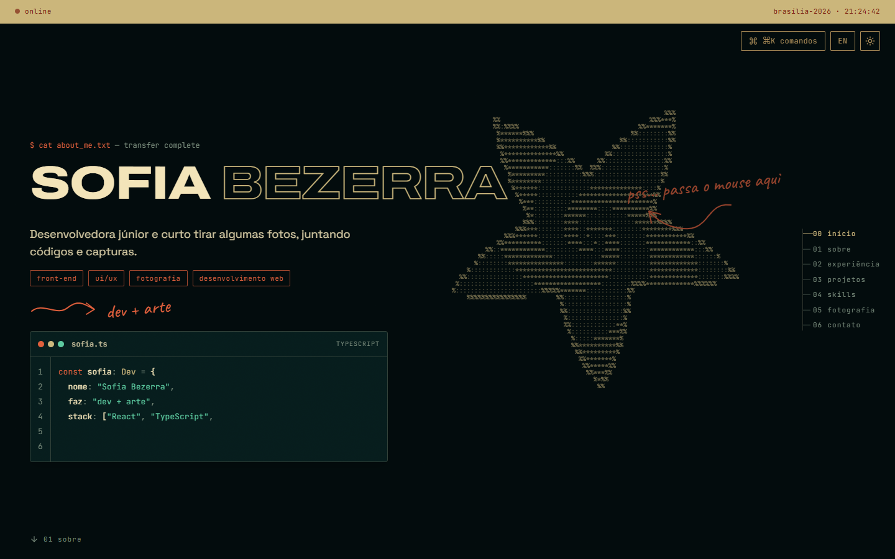

# Sofia Bezerra — Portfólio

**[sofiabezerra.vercel.app](https://sofiabezerra.vercel.app)** · PT-BR / EN

Desenvolvedora web júnior e fotógrafa em Brasília. Este é o meu portfólio: uma página única com estética de terminal retro, onde o código e as fotos dividem o mesmo espaço.



## O que tem lá

- **Boot screen** estilo CRT com scanlines, barra de transferência e cortina que sobe para revelar o site.
- **Estrela ASCII** desenhada em canvas por um sampler polar (cinco pontas + espiral logarítmica) que reage ao mouse com glitch.
- **Editor de código** que digita um `sofia.ts` caractere a caractere, com tokens coloridos.
- **Câmera analógica em ASCII**: silhueta vetorial amostrada por luminância, montada a partir de caracteres dispersos conforme o scroll; o clique dispara o obturador e abre a galeria.
- **Galeria** com fotografias autorais, navegação por teclado e filme de miniaturas.
- **Terminal funcional** na seção de contato (`help`, `whoami`, `projetos`, `fotos`, `cv`, `sudo contratar`…), com histórico e atalhos clicáveis — comandos em português e inglês.
- **Command palette** (`⌘K`), cursor estilo visor de câmera, tema claro/escuro e troca de idioma persistidos.
- **Formulário de contato** real: validação com Zod, server function, limite de envios por e-mail e armazenamento em banco com RLS — a chave de escrita nunca chega ao navegador.
- Acessível por teclado, respeita `prefers-reduced-motion`, sem overflow horizontal em telas de 390px.

## Stack

React 19 · TypeScript · TanStack Start/Router · Tailwind CSS v4 · Motion · Lenis · Zod · Supabase · Vitest + Testing Library · Vercel

## Rodando localmente

```bash
npm install
npm run dev
```

O formulário de contato depende de credenciais próprias do Supabase (`.env.example` lista as variáveis). Sem elas, o restante do site funciona normalmente e o formulário avisa que o envio não está configurado.

## Sobre o conteúdo

Textos, fotografias e identidade visual são autorais e não estão liberados para reutilização. O código está publicado como amostra do meu trabalho.

---

© Sofia Bezerra Belém · [GitHub](https://github.com/sofiabbz) · [LinkedIn](https://www.linkedin.com/in/sofia-bezerra-belem)
